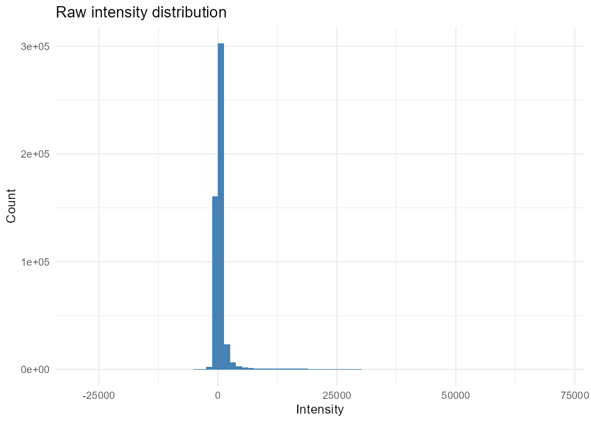
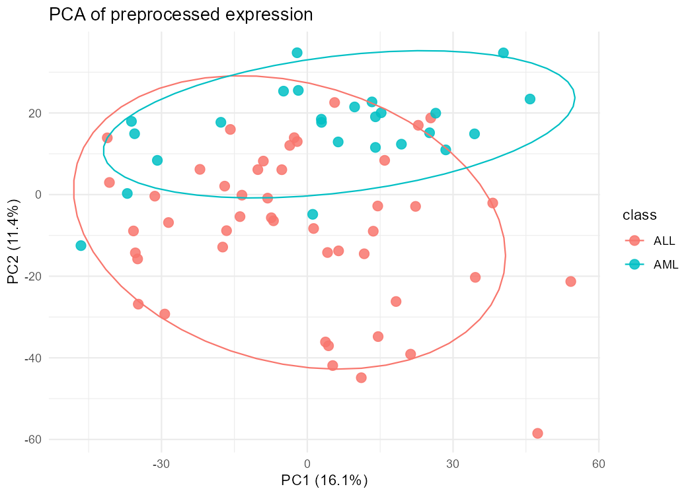
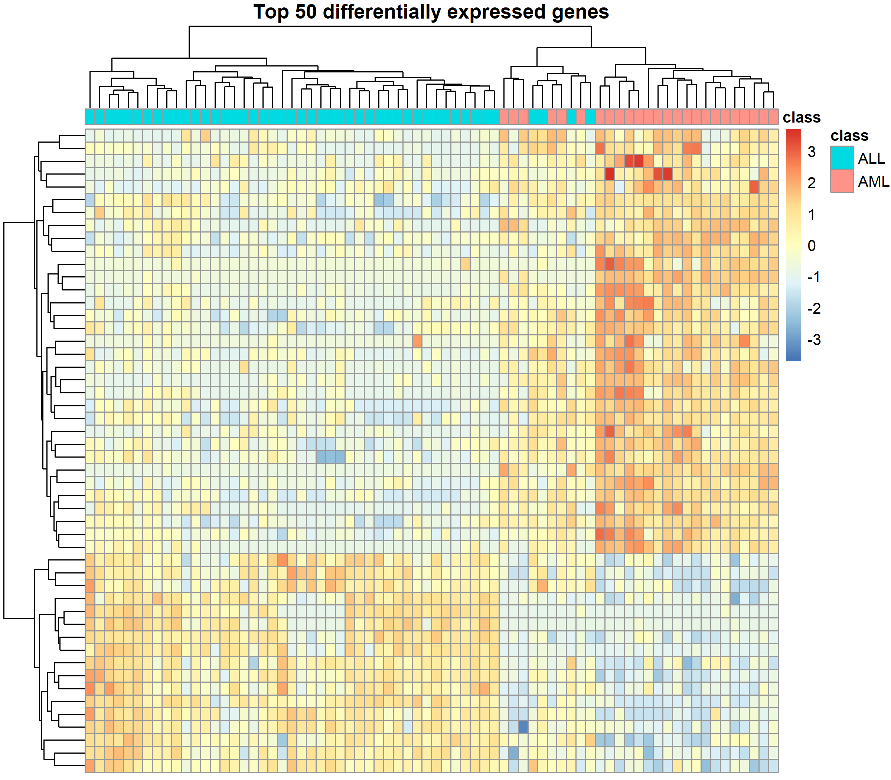
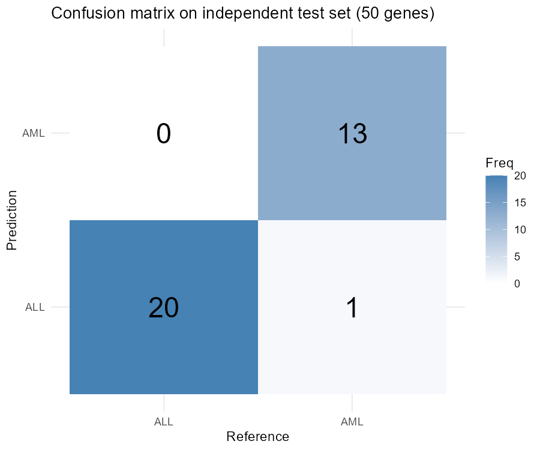

# Classifying AML vs ALL Leukaemia from Gene Expression Data

**Student:** H.A.K Chamikara Madushanka (Reg. No: `<REG-NUMBER>`)
**Module:** Bioinformatics, ICA 3, B.Sc. (Hons) Information Technology, University of Vavuniya

> Replace everything in `<angle brackets>` with your own numbers and text after knitting `code/analysis.Rmd`. Delete this note and the guidance lines in *italics* before submitting. Target length: 1,500-2,500 words excluding references.

## 1. Abstract

*Max 150 words. Write this last. Cover: problem, data, methods, key result, conclusion.*

Acute leukaemia is split into acute lymphoblastic (ALL) and acute myeloid (AML) types, which need different treatments. Using the public Golub et al. (1999) microarray dataset (72 patients, `<N>` genes after filtering), I performed differential expression analysis with limma and trained a linear SVM on the top-ranked genes. `<N>` genes were differentially expressed between AML and ALL. The classifier achieved `<XX>%` accuracy on an independent test set of 34 samples. These results show that a small gene panel can separate the two leukaemia types.

## 2. Introduction

*~250-350 words.*

- What ALL and AML are, and why distinguishing them matters (different chemotherapy regimens, prognosis). Cite a source.
- Why gene expression is useful for diagnosis and biomarker discovery.
- Brief note on the Golub 1999 study as a landmark for class prediction.
- **Aim:** identify genes that distinguish AML from ALL and build a classifier that predicts leukaemia type from expression.
- **Hypothesis:** a small subset of differentially expressed genes is sufficient for accurate classification of unseen samples.

## 3. Data

*~200 words.*

- **Source:** Golub et al. (1999), bone marrow samples from acute leukaemia patients, distributed through the Bioconductor package `golubEsets`.
- **Size:** 72 samples (47 ALL, 25 AML), 7,129 Affymetrix probe sets. Original split: 38 training (27 ALL / 11 AML), 34 independent test (20 ALL / 14 AML).
- **Variables:** expression intensity per probe set; sample metadata (ALL/AML class, B/T cell subtype, gender, source).
- **Ethics and licence:** `<state that the data is publicly available, de-identified, and cite the package licence/source>`.

## 4. Methods

*~400-500 words. Justify each choice, not just list it.*

1. **Import and QC:** loaded with `golubEsets`; checked for missing values (`<none>`); inspected the intensity distribution.
2. **Preprocessing:** floor 100 / ceiling 16,000, filtered genes (max/min > 5 and max-min > 500), log2 transform. *Why: array intensities are skewed, noisy at the low end, and saturate at the high end.*
3. **EDA:** per-sample boxplots, PCA, hierarchical clustering (Ward, Euclidean).
4. **Differential expression:** `limma` linear model with empirical Bayes moderation, Benjamini-Hochberg correction, thresholds adj. P < 0.05 and |log2FC| > 1. *Why limma: moderated t-statistics are well suited to small sample sizes.*
5. **Classification:** limma ranking on the training set only, top *k* genes, linear SVM (`caret` + `e1071`), 5-fold CV repeated 5 times, tuned cost, evaluated once on the independent test set. *Why: selecting genes on all samples would leak test information and inflate accuracy.*
6. **Sensitivity analysis:** performance for k = 2 to 250 genes.

Packages: R `<version>`, limma `<v>`, caret `<v>`, e1071 `<v>`, pheatmap `<v>`, tidyverse `<v>`.

## 5. Results

### 5.1 Data quality and preprocessing




*Caption: describe skew before and distribution after. State genes kept (`<N>` of 7,129).*

### 5.2 Exploratory analysis



*Caption + 2-3 sentences: how much variance PC1/PC2 explain, whether AML and ALL separate.*


*Report how well a 2-cluster cut matches the true classes (from the table in the Rmd).*

### 5.3 Differential expression




*Report: number of significant genes, number up in AML vs up in ALL.*

| Probe | Gene description | log2FC | adj. P |
|-------|------------------|--------|--------|
| `<paste from results/top10_markers.csv>` | | | |

### 5.4 Classification

*Report: best cost, CV AUC, and test-set accuracy, sensitivity, specificity and kappa from `confusionMatrix`.*




## 6. Discussion

*~400-500 words.*

- Interpret the top genes: look up 3-5 of them (GeneCards/UniProt/PubMed) and explain their known roles in myeloid or lymphoid biology. Compare with the findings of Golub et al. 1999.
- Why a small gene panel works, and what the k-sweep shows.
- **Limitations:** small sample size (72), older microarray platform, single study and single cohort, no external validation, no batch or clinical covariates, a test set of only 34 so accuracy has a wide confidence interval (report the CI from `confusionMatrix`).
- **Implications:** potential for rapid molecular diagnosis; would need validation on larger independent cohorts and on RNA-seq before any clinical use.

## 7. Conclusion and future work

*~100-150 words.* Restate the main result. Future work: validate on other leukaemia datasets (e.g. from GEO), try random forest or elastic-net, add pathway enrichment (`clusterProfiler`), test on RNA-seq data.

## 8. Reproducibility

```r
# 1. Install packages
install.packages("BiocManager")
BiocManager::install(c("golubEsets", "Biobase", "limma"))
install.packages(c("tidyverse", "caret", "e1071", "pheatmap", "rmarkdown"))

# 2. Render the full analysis (from the repository root)
rmarkdown::render("code/analysis.Rmd")
```

- Data are loaded directly from the `golubEsets` package, so no download is needed.
- Random seed is fixed (`set.seed(2026)`).
- Full package versions are printed by `sessionInfo()` at the end of `code/analysis.html`.

**Repository structure**

```
├── README.md
├── code/analysis.Rmd
├── code/analysis.html
├── figures/
└── results/
```

## 9. References

*Use one consistent style (e.g. Harvard). Minimum:*

- Golub, T.R. et al. (1999) 'Molecular classification of cancer: class discovery and class prediction by gene expression monitoring', *Science*, 286(5439), pp. 531-537.
- Ritchie, M.E. et al. (2015) 'limma powers differential expression analyses for RNA-sequencing and microarray studies', *Nucleic Acids Research*, 43(7), e47.
- Kuhn, M. (2008) 'Building predictive models in R using the caret package', *Journal of Statistical Software*, 28(5).
- Dudoit, S., Fridlyand, J. and Speed, T.P. (2002) 'Comparison of discrimination methods for the classification of tumors using gene expression data', *JASA*, 97(457), pp. 77-87.
- Bioconductor package `golubEsets` (cite version and URL).
- Add 1-2 references on AML/ALL clinical background.
