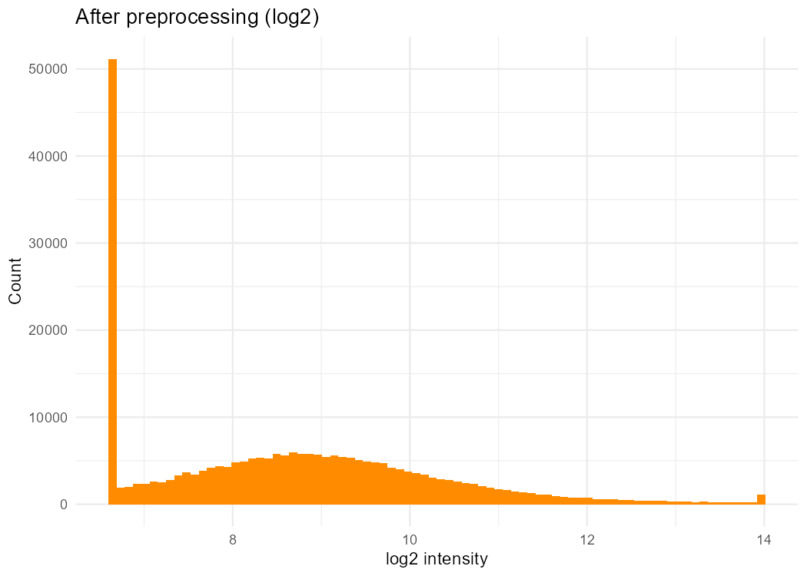
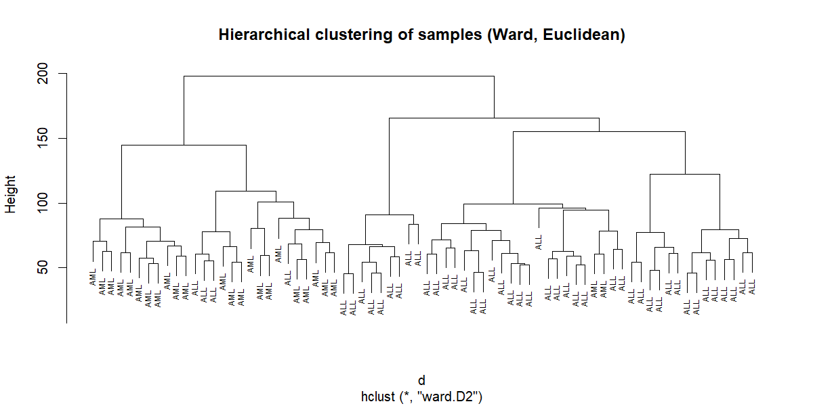
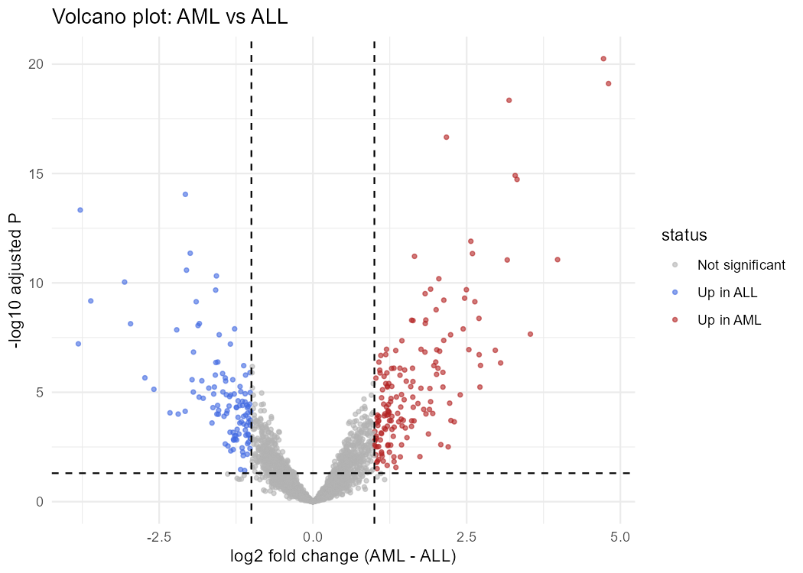
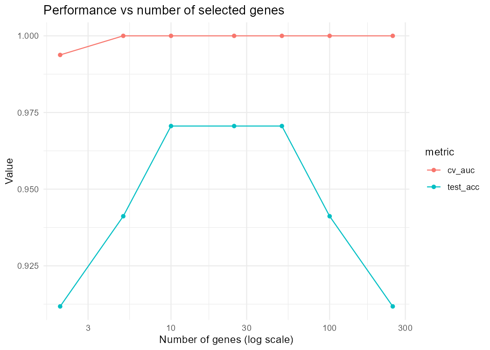

# Classifying AML vs ALL Leukaemia from Gene Expression Data

**Student:** H.A.K Chamikara Madushanka (Reg. No: 2021ICT29)
**Module:** Bioinformatics, ICA 3, B.Sc. (Hons) Information Technology, University of Vavuniya

## 1. Abstract

Acute lymphoblastic leukaemia (ALL) and acute myeloid leukaemia (AML) are treated differently, so accurate classification matters. Using the public Golub et al. (1999) microarray dataset (72 patients), I filtered and log-transformed the expression data (3,571 of 7,129 probe sets retained), then used limma for differential expression and trained a linear support vector machine (SVM) on the top 50 genes selected from the training set only. Limma identified 276 genes with adjusted P < 0.05 and |log2 fold change| > 1. On the independent test set of 34 samples, the classifier reached 97.1% accuracy (95% CI 84.7-99.9%), misclassifying one AML sample. A small gene panel can therefore separate the two leukaemia types, although validation on larger cohorts is needed.

## 2. Introduction

Acute leukaemias are cancers of blood-forming cells, and the two main types, acute lymphoblastic leukaemia (ALL) and acute myeloid leukaemia (AML), arise from different cell lineages: lymphoid in ALL and myeloid in AML (Döhner et al., 2015; Hunger and Mullighan, 2015). They respond to different chemotherapy regimens, so distinguishing them quickly and correctly is essential for choosing treatment (Döhner et al., 2015; Hunger and Mullighan, 2015). Traditionally this relies on a combination of morphology, cytochemistry and immunophenotyping, which requires expert interpretation.

Gene expression profiling offers a data-driven alternative. Golub et al. (1999) showed that expression patterns measured on microarrays could be used to discover and predict cancer classes, and their leukaemia dataset has since become a standard benchmark for classification methods (Dudoit et al., 2002).

**Aim:** to identify genes that distinguish AML from ALL and to build a classifier that predicts leukaemia type from expression data.

**Hypothesis:** a small subset of differentially expressed genes is sufficient to classify unseen samples accurately.

## 3. Data

- **Source:** Golub et al. (1999), accessed through the Bioconductor package `golubEsets` (v1.54.0).
- **Samples:** 72 patients with acute leukaemia: 47 ALL and 25 AML. The data come with the published split into a **training set of 38 samples (27 ALL, 11 AML)** and an **independent test set of 34 samples (20 ALL, 14 AML)**.
- **Variables:** expression intensity for 7,129 Affymetrix (Hu6800) probe sets per sample, plus sample metadata including class (ALL/AML), cell lineage, gender and tissue source.
- **Ethics and licence:** the data are public and de-identified and were obtained from a published study distributed through Bioconductor. Licence terms are given in the package description on Bioconductor (https://bioconductor.org/packages/golubEsets).

## 4. Methods

All analysis was carried out in R 4.6.2 using an R Markdown notebook (`code/analysis.Rmd`).

**Import and quality control.** The data were loaded from `golubEsets` as an ExpressionSet. I checked for missing values and inspected the intensity distribution, which was strongly right-skewed (Figure 1), motivating transformation.

**Preprocessing.** Following the standard approach for this dataset (Dudoit et al., 2002), intensities were floored at 100 and capped at 16,000, because values outside this range are unreliable on this platform. Genes were kept only if the maximum/minimum ratio across samples exceeded 5 and the maximum minus minimum exceeded 500, removing genes with little variation. The remaining values were log2-transformed to stabilise variance.

**Exploratory analysis.** I compared per-sample distributions with boxplots, performed principal component analysis (PCA) on scaled data, and carried out hierarchical clustering (Euclidean distance, Ward's method) without using class labels, to see whether the two leukaemia types separate naturally.

**Differential expression.** I used `limma` (Ritchie et al., 2015), which fits a linear model per gene and applies empirical Bayes moderation of variances. This is well suited to small sample sizes. P-values were adjusted with the Benjamini-Hochberg method. Genes with adjusted P < 0.05 and |log2 fold change| > 1 were considered significant. The comparison is AML minus ALL, so positive fold changes mean higher expression in AML.

**Classification.** To prevent information leaking from the test set, gene ranking was repeated using the 38 training samples only, and the top 50 genes were selected. A linear SVM (`caret` with the `e1071` backend; Kuhn, 2008) was trained on centred and scaled expression, with the cost parameter tuned over 0.01, 0.1, 1 and 10 using 5-fold cross-validation repeated 5 times. The final model was evaluated once on the 34 independent test samples using a confusion matrix, accuracy, sensitivity, specificity and Cohen's kappa.

**Sensitivity analysis.** The pipeline was repeated using the top 2, 5, 10, 25, 50, 100 and 250 genes to see how performance depends on panel size. The choice of 50 genes was made before running this analysis.

## 5. Results

### 5.1 Quality control and preprocessing


**Figure 1.** Distribution of raw expression intensities, which are strongly right-skewed.



**Figure 2.** Distribution after flooring, capping, filtering and log2 transformation. The distribution is much more symmetric after transformation.

After filtering, **3,571 of 7,129 probe sets** were retained.

### 5.2 Exploratory analysis


**Figure 3.** PCA of the preprocessed data. PC1 and PC2 explain 16.1% and 11.4% of the variance (27.5% together).



**Figure 4.** Hierarchical clustering of all 72 samples, labelled by true class.

Cutting the tree into two clusters, without using labels, produced one cluster of 45 samples (43 ALL, 2 AML) and one of 27 samples (4 ALL, 23 AML). So 66 of 72 samples (91.7%) fell in the cluster matching their true class, which suggests that the AML/ALL difference is a major source of variation in the data.

### 5.3 Differential expression

Limma identified **276 genes** with adjusted P < 0.05 and |log2 fold change| > 1, shown in red (higher in AML) and blue (higher in ALL) in Figure 5.



**Figure 5.** Volcano plot of AML vs ALL. Red points are significantly higher in AML and blue points significantly higher in ALL.


**Figure 6.** Heatmap of the 50 most significant genes (row-scaled). Samples cluster by class.

**Table 1.** Top 10 differentially expressed probe sets (log2FC = AML minus ALL).

| Probe set | Gene symbol | log2FC | Adj. P | Higher in |
|---|---|---|---|---|
| M84526_at | CFD | 4.73 | 5.6e-21 | AML |
| M27891_at | CST3 | 4.81 | 7.7e-20 | AML |
| U46499_at | MGST1 | 3.19 | 4.5e-19 | AML |
| M23197_at | CD33 | 2.17 | 2.2e-17 | AML |
| X95735_at | ZYX | 3.29 | 1.2e-15 | AML |
| D88422_at | CSTA | 3.32 | 1.9e-15 | AML |
| M31523_at | TCF3 | -2.07 | 8.9e-15 | ALL |
| M11722_at | DNTT | -3.78 | 4.7e-14 | ALL |
| L09209_s_at | APLP2 | 2.57 | 1.2e-12 | AML |
| J05243_at | SPTAN1 | -1.99 | 4.4e-12 | ALL |

### 5.4 Classification

On the 34 independent test samples, the SVM using the top 50 training-set genes achieved an accuracy of **97.1% (33/34; 95% CI 84.7-99.9%)**, compared with 58.8% for always predicting the majority class (P = 3.6e-7). Cohen's kappa was 0.94. Sensitivity for AML was 92.9% (13/14) and specificity was 100% (20/20). One AML sample was predicted as ALL.


**Figure 7.** Confusion matrix on the independent test set.

Cross-validated AUC on the training set was 1.0 for all four cost values, so the classes were perfectly separable in the training data and the cost value of 0.01 was selected only because the values tied.



**Figure 8.** Cross-validated AUC and test accuracy for different numbers of selected genes.

**Table 2.** Effect of panel size.

| Genes (k) | CV AUC | Test accuracy |
|---|---|---|
| 2 | 0.994 | 0.912 |
| 5 | 1.000 | 0.941 |
| 10 | 1.000 | 0.971 |
| 25 | 1.000 | 0.971 |
| 50 | 1.000 | 0.971 |
| 100 | 1.000 | 0.941 |
| 250 | 1.000 | 0.912 |

Test accuracy rose from 91.2% with 2 genes to 97.1% with 10-50 genes and declined slightly with larger panels. Because each test sample accounts for 2.9 percentage points, these differences correspond to only one to three samples.

## 6. Discussion

**Interpretation.** AML and ALL separate strongly in expression space. Even without labels, hierarchical clustering recovered 91.7% of the true classes. Among the top differentially expressed probe sets are genes with known roles in lineage identity. CD33 (M23197_at), higher in AML, is a well-known myeloid surface marker, whereas DNTT (M11722_at), which encodes terminal deoxynucleotidyl transferase and was higher in ALL, is a marker of immature lymphoid cells. TCF3 (M31523_at), also higher in ALL, encodes a transcription factor involved in lymphocyte development. Other AML-associated genes, such as CST3, CSTA and ZYX, are consistent with a myeloid expression programme. That the strongest signals correspond to known myeloid and lymphoid biology supports the biological plausibility of the classifier.

**Classifier performance.** A linear SVM using only 50 of 3,571 genes classified 33 of 34 unseen samples correctly. A panel of just 10 genes performed equally well on this test set, and even 2 genes gave 91.2%, indicating a very strong, low-dimensional signal. Performance did not improve with larger panels, which is consistent with additional genes contributing mostly noise in a dataset with few samples.

**Limitations.**
- *Small sample size.* With 72 samples, and only 34 in the test set, a single error changes accuracy by about 3 points. The 95% confidence interval for test accuracy (84.7-99.9%) is wide.
- *Optimistic cross-validation.* Genes were ranked using all 38 training samples before cross-validation, so the cross-validated AUC of 1.0 is optimistic. The test-set result is the more honest estimate. A fully nested approach would select genes inside each fold.
- *Single study and platform.* The data come from one study using an older microarray platform. Batch effects, tissue source and patient differences were not modelled, and the results are not validated on an external cohort.
- *Easy classification problem.* ALL and AML are biologically distant, and this benchmark is known to be relatively easy. Performance on subtler classes, such as disease subtypes or treatment response, would likely be lower.
- *Annotation.* The dataset has no gene annotation, so gene identities were looked up manually from probe IDs.

**Implications.** The results suggest that a small expression panel could in principle support rapid leukaemia typing. However, this is a retrospective analysis of a small public dataset and is not evidence for clinical use. Clinical translation would require validation on larger independent cohorts, on current RNA-seq technology, and against standard diagnostic methods.

## 7. Conclusion and future work

AML and ALL can be distinguished using a compact set of genes. A linear SVM trained on 50 genes chosen from the training data classified 97.1% of independent test samples correctly, and unsupervised clustering alone recovered 91.7% of true classes. Future work could include nested cross-validation, comparison with other classifiers (random forest, elastic net), gene ontology and pathway enrichment of the differentially expressed genes (e.g. with `clusterProfiler`), mapping probe sets to gene symbols with annotation packages, and validation on independent leukaemia datasets from GEO.

## 8. Reproducibility

```r
# 1. Install packages
install.packages("BiocManager")
BiocManager::install(c("golubEsets", "Biobase", "limma"))
install.packages(c("tidyverse", "caret", "e1071", "pheatmap", "kernlab", "rmarkdown"))

# 2. Render the analysis from the repository root
rmarkdown::render("code/analysis.Rmd")
```

- Data are loaded directly from the `golubEsets` package, so no download is needed.
- Random seed: `set.seed(2026)`.
- Main package versions: R 4.6.2, Bioconductor 3.23, golubEsets 1.54.0, Biobase 2.72.0, limma 3.68.5, caret 7.1-0, e1071 1.7-17, kernlab 0.9-33, pheatmap 1.0.13, tidyverse 2.0.0, rmarkdown 2.32. The full `sessionInfo()` is at the end of `code/analysis.html`.

**Repository structure**

```
├── README.md
├── code/analysis.Rmd
├── code/analysis.html
├── figures/
└── results/
```

## 9. References

- Döhner, H., Weisdorf, D.J. and Bloomfield, C.D. (2015) 'Acute myeloid leukemia', *New England Journal of Medicine*, 373(12), pp. 1136-1152.
- Dudoit, S., Fridlyand, J. and Speed, T.P. (2002) 'Comparison of discrimination methods for the classification of tumors using gene expression data', *Journal of the American Statistical Association*, 97(457), pp. 77-87.
- Golub, T.R. et al. (1999) 'Molecular classification of cancer: class discovery and class prediction by gene expression monitoring', *Science*, 286(5439), pp. 531-537.
- Hunger, S.P. and Mullighan, C.G. (2015) 'Acute lymphoblastic leukemia in children', *New England Journal of Medicine*, 373(16), pp. 1541-1552.
- Huber, W. et al. (2015) 'Orchestrating high-throughput genomic analysis with Bioconductor', *Nature Methods*, 12(2), pp. 115-121.
- Kuhn, M. (2008) 'Building predictive models in R using the caret package', *Journal of Statistical Software*, 28(5), pp. 1-26.
- Ritchie, M.E. et al. (2015) 'limma powers differential expression analyses for RNA-sequencing and microarray studies', *Nucleic Acids Research*, 43(7), e47.
- Wickham, H. et al. (2019) 'Welcome to the tidyverse', *Journal of Open Source Software*, 4(43), 1686.
- Bioconductor package `golubEsets` v1.54.0. https://bioconductor.org/packages/golubEsets
